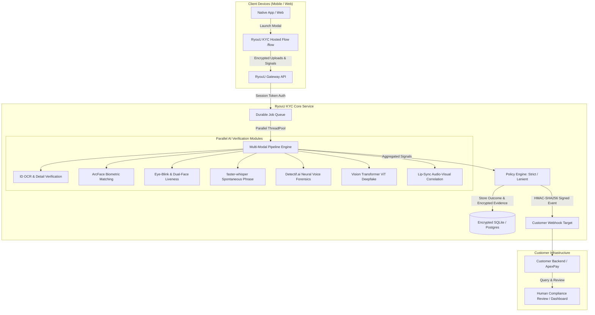

# RyouU KYC — AI Biometric & Anti-Spoofing Identity Verification

[](https://fastapi.tiangolo.com)
[](https://python.org)
[](https://developer.android.com)
[](https://reactnative.dev)
[](https://cryptography.io)
[](LICENSE)

**RyouU KYC** is an enterprise-grade, multi-layered identity verification engine engineered for high-assurance fintech, banking, and digital onboarding. It features state-of-the-art anti-spoofing defense, deepfake detection, real-time biometric matching, and multi-platform native SDKs.

---

## Architecture Overview



---

## Key Features & Fraud Defenses

### 1. Document Extraction & Cross-Verification (`id_details`)
* **Engines**: `EasyOCR` (CRAFT detection + CRNN text recognition) with OpenCV morphological preprocessing.
* **Fuzzy Field Alignment**: Token-based fuzzy matching via `RapidFuzz` matches names even across OCR character noise, inverted name order, or accented characters.
* **Date of Birth & Age Verification**: Multi-pattern regex extraction checks declared DOB against the physical document.

### 2. Biometric Face Verification (`face_match`)
* **Engines**: `InsightFace` (`RetinaFace` + `ArcFace` ResNet-50) on ONNX Runtime.
* **Vector Embeddings**: Extracts a 512-dimensional normalized biometric feature vector from the ID card photo and live selfie.
* **Cosine Similarity**: Verifies true facial geometry matches with configurable acceptance boundaries ($\ge 0.40$).
* **Cross-Session Deduplication**: Hashes face embeddings across historical sessions to instantly flag synthetic identities or repeat fraud rings applying under different names.

### 3. Active Liveness & Dual-Identity Cross-Check (`liveness`)
* **Third-Party / Friend Impersonation Defense**: Samples challenge video frames and cross-checks the facial embedding against **both** the selfie and ID card photo. If a friend substitutes during the liveness recording, the session is **immediately rejected**.
* **Eye Blink Verification (EAR)**: Computes Eye Aspect Ratio using 68-point 3D facial landmarks:
  $$\text{EAR} = \frac{\lVert p_{37} - p_{41} \rVert + \lVert p_{38} - p_{40} \rVert}{2 \lVert p_{36} - p_{39} \rVert}$$
  Differentiates a living human from 2D paper masks, static cutouts, and screen replay attacks.
* **Server-Side Head Pose Estimation**: Tracks 3D pitch/yaw/roll directly from uploaded video packets to prevent spoofed client-side metrics.

### 4. Acoustic Deepfake & Voice Cloning Defense (`voice_ai`)
* **Forensics**: Powered by **Detectif.ai API** neural audio forensics.
* **Artifact Detection**: Analyzes acoustic spectrograms for neural vocoder artifacts, text-to-speech cadence, and voice clone signatures (e.g. ElevenLabs, Tortoise, Bark).

### 5. Spontaneous Spoken Phrase Challenge (`spoken_details`)
* **Engine**: `faster-whisper` (`base.en` CTranslate2 int8 model).
* **Phonetic Biasing**: Whisper decoder is primed with dynamic vocabulary hints (`initial_prompt`) for near-zero error transcription in $< 1.2$ seconds.
* **Time-Bound Ephemeral Challenges**: Issues 4 random digits + 2 common dictionary words with 60-second TTL to defeat pre-recorded playback attacks.
* **Compound Tolerance**: Handles colloquial and compound splits (`"rainbow"` vs `"rain bow"`) with space-normalized fuzzy ratios.

### 6. Vision Transformer Deepfake Classifier (`video_deepfake`)
* **Engine**: `prithivMLmods/Deep-Fake-Detector-v2-Model` (ViT-Base).
* **Artifact Inspection**: Scans high-resolution facial crops for GAN blending boundaries, synthetic skin texture smoothing, and digital face-swap seams (calibrated at $\ge 90\%$ confidence to eliminate false alarms).

### 7. Multi-Modal Lip-Sync Correlation (`lip_sync`)
* **Engine**: PyAV audio energy envelope + 3D facial aperture metrics.
* **Dubbing Defense**: Calculates the Pearson correlation coefficient between mouth opening/closing and audio RMS volume to prevent off-camera voiceover attacks.

---

## Multi-Platform SDK Ecosystem

| Platform | Location | Type | Description |
| :--- | :--- | :--- | :--- |
| **Android SDK** | `sdk/android` | Native AAR | Jetpack Compose & XML BottomSheet modal with persistent WebView state across camera captures. |
| **React Native SDK** | `sdk/react-native` | TypeScript / JSX | Cross-platform `<UncloneKycModal />` sheet with native bridge listeners. |
| **Python SDK** | `sdk/python` | Package (`unclone-kyc`) | Backend client for session provisioning, status querying, and webhook HMAC verification. |
| **Node.js SDK** | `sdk/node` | TypeScript / NPM | Server-side TypeScript client with full typing and signature verification. |

### Android SDK Integration

Add the local repository to your app's `settings.gradle.kts`:
```kotlin
dependencyResolutionManagement {
    repositories {
        google()
        mavenCentral()
        maven { url = uri("../kyc-service/sdk/android/repo") }
    }
}
```

Add the dependency in `app/build.gradle.kts`:
```kotlin
dependencies {
    implementation("com.ryouu.kyc:sdk:1.0.0")
}
```

Trigger the verification sheet in Jetpack Compose:
```kotlin
import com.ryouu.kyc.ui.RyouUKycModal
import com.ryouu.kyc.model.KycParams

RyouUKycModal(
    isOpen = isKycOpen,
    onClose = { isKycOpen = false },
    onComplete = { result ->
        when (result.status) {
            KycStatus.COMPLETED -> println("Identity Approved!")
            KycStatus.REJECTED -> println("Rejected: ${result.reasons}")
            KycStatus.NEEDS_REVIEW -> println("Under Review")
        }
    },
    params = KycParams(
        name = "Alex Mercer",
        dob = "1994-08-12",
        email = "alex@example.com",
        phone = "9876543210"
    )
)
```

---

## Quickstart

### Prerequisites
- Python 3.10+
- (Optional) Android Studio / Gradle for compiling the Android SDK

### 1. Environment Configuration
Create a `.env` file in the project root:
```env
KYC_DEV_MODE=0
KYC_DATA_DIR=./data
PUBLIC_BASE_URL=http://localhost:8000
FLOW_BASE_URL=http://localhost:8000/flow
KYC_CORS_ORIGINS=*

# Detectif.ai API Key (for synthetic voice defense)
DETECTIF_API_KEY=your_detectif_api_key

# SMTP Configuration (for real Email OTP)
SMTP_HOST=smtp.gmail.com
SMTP_PORT=587
SMTP_USER=your_email@gmail.com
SMTP_PASS=your_app_password
SMTP_FROM=your_email@gmail.com

# SMS OTP Configuration (Fast2SMS or Twilio)
FAST2SMS_API_KEY=your_fast2sms_key

# Model Configurations
WHISPER_MODEL=base.en
FACE_PASS_SIM=0.40
DEEPFAKE_FAIL=0.90
```

### 2. Install Dependencies
```bash
python -m venv .venv
# On Linux/macOS:
source .venv/bin/activate
# On Windows:
.venv\Scripts\activate

pip install -r requirements-dev.txt
pip install -r requirements-ml.txt
```

### 3. Run the Services
**Terminal 1 — KYC Core Service**:
```bash
uvicorn app.main:app --port 8000 --reload
```

**Terminal 2 — Reference Customer App (ApexPay)**:
```bash
uvicorn demo_client.app:app --port 9000 --reload
```

**Terminal 3 — Reverse Port Forwarding for Physical Device**:
```bash
adb reverse tcp:8000 tcp:8000
adb reverse tcp:9000 tcp:9000
```

* Swagger API documentation is available at `http://localhost:8000/docs`.
* Hosted Web Flow demo: `http://localhost:8000/flow`.

---

## REST API Reference

All customer API endpoints require an API key passed in the authorization header:  
`Authorization: Bearer <api_key>`

### 1. Create Verification Session
`POST /v1/verifications`
```json
{
  "reference_id": "APX-USR-89421",
  "policy": "strict",
  "expected": {
    "name": "Alex Mercer",
    "dob": "1994-08-12",
    "id_last4": "5512"
  }
}
```
**Response (`201 Created`)**:
```json
{
  "id": "ver_55d84d4a03d54eacaed1",
  "status": "created",
  "policy": "strict",
  "expires_at": 1792223745,
  "flow_url": "http://localhost:8000/flow?v=ver_55d84d4a03d54eacaed1&t=dT8Ifxy30lIQ..."
}
```

### 2. Retrieve Status & Verdict
`GET /v1/verifications/{id}`
```json
{
  "id": "ver_55d84d4a03d54eacaed1",
  "reference_id": "APX-USR-89421",
  "status": "completed",
  "decision": "approved",
  "final_decision": "approved",
  "trust": 0.9421,
  "reasons": [],
  "results": [
    {"name": "id_details", "status": "pass", "score": 1.0},
    {"name": "face_match", "status": "pass", "score": 0.6278},
    {"name": "liveness", "status": "pass", "score": 1.0},
    {"name": "voice_ai", "status": "pass", "score": 0.98}
  ]
}
```

### 3. Expiring Evidence Access
`GET /v1/verifications/{id}/evidence`  
Returns signed, time-limited download URLs for decrypted audit artifacts (`selfie`, `id_image`, `challenge_video`, `challenge_audio`).

---

## Webhook Verification

Events are delivered to your configured `webhook_url` with HMAC-SHA256 signatures:
```http
X-KYC-Signature: t=1792222110,v1=9e5df2b8f72c084f7b6058bcf7723910c85c392c60e3346f8c7407a16f94b28c
```

**Python Verification**:
```python
from unclone_kyc import verify_webhook

is_valid = verify_webhook(
    secret="whsec_demo",
    payload=request.body,
    signature_header=request.headers.get("X-KYC-Signature")
)
```

---

## Security & Storage Architecture

- **Field-Level Data Encryption**: All user uploads (selfies, ID documents, voice/video challenges) are encrypted at rest with Fernet (AES-128-CBC + HMAC-SHA256).
- **Transient Memory Decryption**: Evidence is only decrypted in memory during the execution of verification checks and immediately flushed after completion.
- **Fail-Secure Architecture**: If an unexpected exception occurs inside any verification module, the session defaults to `needs_review` or `rejected_recommended` — an unhandled error **never** approves an applicant.

---

## License

This project is licensed under the [MIT License](LICENSE).
