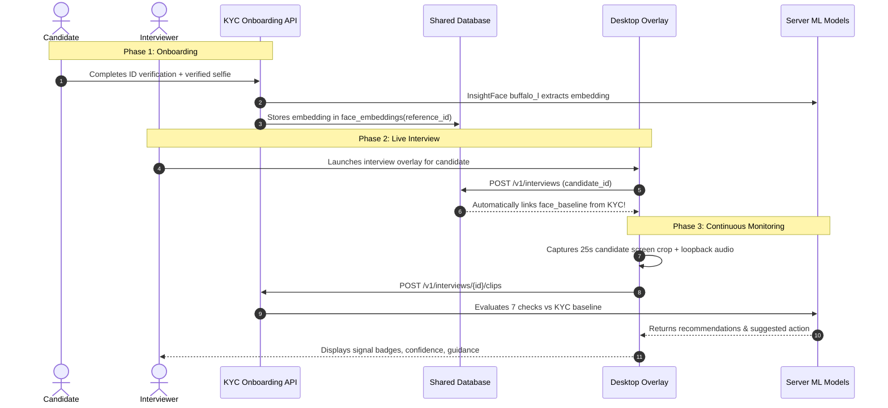

# RyouU Suite - Unified Data Model & Cross-Session Architecture

**Specification Version:** 2.0  
**Status:** Implemented & Unified  
**Targets:** `kyc-service` (Web Onboarding) & `apps/overlay` (Desktop Meeting Monitor)

---

## 1. Overview & Architectural Principle

The RyouU platform provides an end-to-end identity verification pipeline spanning two operational stages:
1. **Self-Serve KYC Onboarding (`kyc-service`)**: Asynchronous document OCR, active/passive liveness challenges, and face embedding extraction.
2. **Live Interview Integrity Monitoring (`apps/overlay`)**: Real-time non-intrusive desktop overlay capturing candidate video and system loopback audio during live interviews (Zoom, Teams, Meet).

Rather than treating the meeting overlay as a disconnected utility, the suite integrates both modalities under a **single unified database layer**. When a candidate completes KYC verification, their biometric signatures (facial embeddings and voiceprints) act as the biometric ground truth against which live meeting clips are evaluated.

```
+-----------------------------------------------------------------------------------+
|                                  TENANT ACCOUNT                                   |
+-----------------------------------------------------------------------------------+
                                         |
            +----------------------------+----------------------------+
            |                                                         |
            v                                                         v
+-----------------------+                                 +-----------------------+
|    KYC ONBOARDING     |                                 |   INTERVIEW OVERLAY   |
|  (/flow/{vid}/...)    |                                 | (/v1/interviews/...)  |
+-----------------------+                                 +-----------------------+
            |                                                         |
            | (Extracts Verified Face & Voice)                        | (Queries Baseline)
            v                                                         v
+-----------------------------------------------------------------------------------+
|                            SHARED BIOMETRIC GROUND TRUTH                          |
|                       face_embeddings  |  speaker_voiceprints                     |
+-----------------------------------------------------------------------------------+
                                         |
                                         v
                         Cross-Session Continuity & Anti-Fraud
                         - Impersonation Detection (Candidate != KYC)
                         - Proxy / Second Person Detection
                         - Deepfake & Voice Synthesis Flags
```

---

## 2. Core Entities

### 2.1 `tenants`
Organizations issuing verifications and conducting technical interviews.
- `id` (VARCHAR PK): Unique tenant ID (e.g., `demo_lenient`, `tenant_abc`).
- `name` (TEXT): Display name.
- `api_key_hash` (TEXT UNIQUE): SHA-256 hash of tenant API key (`Authorization: Bearer <key>`).
- `webhook_url` (TEXT): Destination URL for automated callback events.
- `webhook_secret` (TEXT): Shared HMAC secret for webhook payload signing.
- `default_policy` (TEXT): Default verification policy (`lenient`, `standard`, `strict`).
- `created_at` (DOUBLE): Unix epoch timestamp.

### 2.2 `verifications` (KYC Sessions)
Self-serve onboarding flows for candidate document and liveness checks.
- `id` (VARCHAR PK): Verification ID prefix `ver_` (e.g., `ver_018f...`).
- `tenant_id` (TEXT FK): Owning tenant.
- `reference_id` (TEXT): Candidate/applicant identifier in tenant's ATS or HRIS.
- `policy` (TEXT): Active policy applied.
- `status` (TEXT): `created` | `processing` | `completed` | `failed` | `expired`.
- `decision` (TEXT): `approved` | `needs_review` | `rejected`.
- `flow_token_hash` (TEXT): SHA-256 hash of single-use web flow token.
- `expires_at` (DOUBLE): Session expiration timestamp.
- `data` (JSON): Session state (expected details, uploaded file paths, verified transcripts, signals).
- `results` (JSON): List of check results conforming to `CheckResult`.
- `trust` (DOUBLE): Trust score (0.0 to 1.0).
- `created_at`, `updated_at` (DOUBLE): Timestamps.

### 2.3 `interviews` (Meeting Overlay Sessions)
Live interview verification sessions monitored via the desktop overlay.
- `id` (VARCHAR PK): Interview ID prefix `iv_` (e.g., `iv_89a7...`).
- `tenant_id` (TEXT FK): Owning tenant.
- `candidate_id` (TEXT): Candidate reference ID. Automatically links to KYC `reference_id`.
- `token_hash` (TEXT): SHA-256 hash of desktop overlay session token (`X-Interview-Token`).
- `status` (TEXT): `active` | `completed` | `expired`.
- `metadata` (JSON): Meeting context (e.g. `{ meeting_app: "Zoom", job_title: "Staff Engineer" }`).
- `face_baseline` (JSON): Normalized 512-dim face embedding list. Pre-populated from KYC or enrolled in Round 1.
- `speaker_id` (TEXT): Detectif.ai Eidos enrolled speaker ID.
- `created_at`, `expires_at`, `updated_at` (DOUBLE): Timestamps.

### 2.4 `interview_clips`
Discrete 25-second evaluation chunks recorded by the desktop overlay during interview rounds.
- `id` (VARCHAR PK): Clip ID prefix `clip_` (e.g., `clip_42e1...`).
- `interview_id` (TEXT FK): Parent interview session.
- `round` (INTEGER): Sequential check round (1, 2, 3...).
- `status` (TEXT): `pending` | `completed` | `failed`.
- `metadata` (JSON): Recording parameters (resolution, fps, meeting app detected, timestamp).
- `video_path` (TEXT): Path to encrypted video chunk.
- `audio_path` (TEXT): Path to isolated speech audio track.
- `results` (JSON): List of all 7 check result objects conforming to `CheckResult`.
- `recommendation` (TEXT): Human-in-the-loop recommendation (`clear`, `caution`, `flagged`).
- `action` (TEXT): Contextual guidance prompt for the human interviewer.
- `created_at` (DOUBLE): Timestamp.

### 2.5 `face_embeddings` (Cross-Session Identity Ground Truth)
Stores normalized face embeddings extracted from verified identity documents, selfies, and initial interview rounds.
- `id` (SERIAL / AUTOINCREMENT PK).
- `tenant_id` (TEXT): Tenant scope.
- `reference_id` (TEXT): Candidate identifier.
- `vid` (TEXT): Originating session ID (`ver_...` or `iv_...`).
- `embedding_json` (TEXT): 512-dimensional normalized facial feature vector.
- `face_hash` (TEXT): Perceptual hash of face crop.
- `created_at` (DOUBLE): Timestamp.

### 2.6 `media_hashes` (Asset Replay Prevention)
Stores SHA-256 digest of media files per tenant to prevent candidates from re-uploading identical pre-recorded video or audio files.
- `tenant_id` (TEXT), `file_hash` (TEXT) -> Composite Primary Key.
- `media_kind` (TEXT): `selfie`, `challenge_video`, `clip_video`.
- `vid` (TEXT): Session ID.
- `created_at` (DOUBLE).

---

## 3. Check Contract: `CheckResult`

Every integrity check across both KYC and the Interview Overlay strictly adheres to the standard contract:

```json
{
  "name": "interview_face_id",
  "status": "pass",
  "score": 0.92,
  "confidence": 0.90,
  "reason": "Face matches enrolled candidate identity",
  "details": {
    "similarity": 0.92,
    "crops_evaluated": 8,
    "min_resolution_px": 60
  }
}
```

### Fields:
1. `name`: Unique check identifier (`interview_voice_auth`, `interview_voice_id`, `interview_face_id`, `interview_deepfake_video`, `interview_second_person`, `interview_loop`, `interview_lip_sync`).
2. `status`:
   - `pass`: Signals meet integrity criteria.
   - `fail`: Signals indicate anomaly or discrepancy.
   - `uncertain`: Insufficient data, audio silence, or service unavailable. (Never falls back to `pass`).
   - `skipped`: Prerequisite input missing.
3. `score`: Normalized trust score from `0.0` (strongly suspicious) to `1.0` (strongly authentic).
4. `confidence`: Trustworthiness of the score itself (`0.0` to `1.0`). Low for short clips or noisy environments.
5. `reason`: Plain-language explanation for non-technical interviewers.
6. `details`: Technical diagnostic metrics, model names, and uncalibrated labels (`threshold_status: "UNCALIBRATED"`).

---

## 4. Cross-Session Verification Lifecycle



---

## 5. Security & Data Protection Posture

1. **Zero Secret Exposure on Client**:
   - The desktop overlay stores zero provider keys (no Detectif.ai keys, no Supabase keys).
   - Desktop communicates exclusively with the server via short-lived HMAC session tokens (`X-Interview-Token`).
   - Tokens stored locally in client memory or encrypted via Electron's `safeStorage`.
2. **Encrypted Evidence at Rest**:
   - Captured video and audio files on the server are encrypted using AES-128-CBC (Fernet) authenticated encryption.
3. **Pure Recommendation Engine**:
   - The platform never labels an applicant "fake" or "fraud" as a definitive statement. It surfaces signals, confidence scores, and suggested interviewer actions, leaving hiring decisions strictly to human interviewers.
